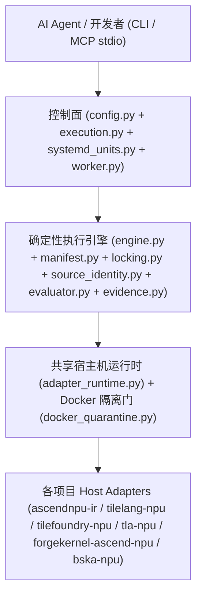
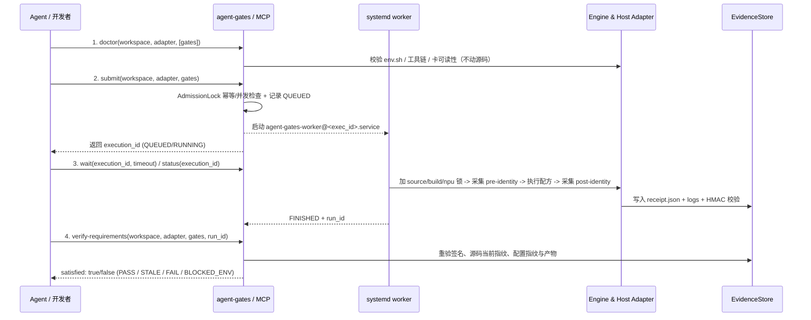

# AgentGates

AgentGates 是一个面向 Ascend AI 编译器开发的 **确定性构建、测试与 NPU 上卡验证门禁系统**（Python 3.11+）。
AI Agent（如 Claude Code / Antigravity / DSH）负责分析与修改编译器源码；AgentGates 负责通过 digest-pinned（SHA-256 固化）的 Adapter 配方执行真实构建、单元测试与 NPU 上卡核验，并生成防篡改的本地收据（`receipt.json`）。

> [!WARNING]
> **当前版本采用 Host-First（宿主机直跑）架构，Docker/容器模式已全面禁用并隔离。**
> 所有活跃项目均在宿主机直接基于目标 `CANN` 与 `Conda/venv` 环境执行。历史遗留容器 Adapter（`tilelang-hivm`、`tilelang-hivm-npu`、`ascend-build` / `ascend-regression` 容器路由及 `create-container.sh` / `docker_gate.py` / `provision.py` 等脚本）已在代码与配置层全面阻断（`DOCKER_MODE_DISABLED`），详见 [Docker 模式隔离说明](docs/docker-mode-quarantine.md)。

---

## 一、活跃 Host-local Adapter 一览

| Adapter ID | 对应项目 | Gate IDs | 需要 NPU | 构建树策略 | `env.sh` 前缀 |
| --- | --- | --- | --- | --- | --- |
| `ascendnpu-ir` | AscendNPU-IR | `ascend-build-host`, `ascend-regression-host` | 否 | 增量 Ninja 或从零 `full-build.sh` | `ASCENDNPU_` |
| `tilelang-npu` | TileLang (Ascend) | `tilelang-npu-build`, `tilelang-npu-examples` | `examples` 需要 | 每轮 CMake/Ninja（宿主 Conda Python） | `TILELANG_NPU_` |
| `tilefoundry-npu` | TileFoundry | `tilefoundry-npu-cpu`, `tilefoundry-npu-device` | `device` 需要（窗口租约） | 无源内构建树；`cpu` 不加载 CANN，`device` 加载 CANN | `TILEFOUNDRY_NPU_` |
| `tla-npu` | triton-ascend (TLA 接口) | `tla-npu-e2e` | 是 | 预编译 wheel + 独立 `TLA_NPU_TEST_DIR` 与隔离缓存 | `TLA_NPU_` |
| `forgekernel-ascend-npu` | ForgeKernel | `forgekernel-ascend-npu-smoke`, `forgekernel-ascend-npu-build` | `smoke` 需要 | `FK_ASCEND_WORK_ROOT` 私有 `--system-site-packages` venv + `--no-deps` 安装 | `FK_ASCEND_` |
| `bska-npu` | cannbot-ops / BSKA | `bska-npu-smoke`, `bska-npu-cannbench` | 是 | 宿主 Conda 直接驱动 CANNBench 原生评测 | `BSKA_NPU_` |

> 已隔离（禁止触发）：`tilelang-hivm`、`tilelang-hivm-npu`、`ascendnpu-ir` 的 `ascend-build` / `ascend-regression`（容器路由）。

---

## 二、总体架构（四层职责边界）



1. **接入层（CLI + MCP）**：
   - CLI 提供同步命令（`list`、`doctor`、`run`、`report`、`verify`）与 V2 异步控制面命令（`submit`、`status`、`wait`、`cancel`、`verify-requirements`）。
   - `python -s -m agent_gates.mcp_server` 通过 MCP stdio 协议向 Agent 暴露 10 个强 Schema 工具；严禁传入自定义命令、容器、解释器、源码路径或设备 ID 等机器参数。
2. **控制与调度层（V2 Control Plane + systemd User Worker）**：
   - `~/.config/agent-gates/config.toml`（权限 `600`）统一声明合法 `workspaces`、允许的 `adapters` / `allowed_gates`、本机 `env.sh` 路径以及 `default_npu_device`。
   - `submit` 在 `submit.lock`（`AdmissionLock`）保护下校验幂等键与 `max_concurrent` 并发上限，并拉起独立的 `systemd --user` 单元 `agent-gates-worker@<execution_id>.service`，使门禁进程与 Agent 会话解耦、不随对话超时被杀。
3. **确定性引擎与证据层（Engine + Leases + Evidence）**：
   - 所有命令和脚本摘要在 `manifest.json` 中通过 SHA-256 固化；`env.sh` 按纯数据 `NAME=VALUE` 解析，禁止 shell 展开，并与调用环境导出冲突检查互相约束。
   - `locking.py` 为 `source:<root>`、`build:<dir>` 与 `npu:<device>` 获取跨进程 `flock` 租约（支持独占模式和 `deviceWindow` 窗口租约）。
   - `source_identity.py` 在执行前后分别对 Git 源码状态（含 `.gitignore` 与未跟踪文件）及忽略产物计算摘要；任何外部并发修改都会使既有收据变为 `STALE`。
   - `evidence.py` 生成带本地 HMAC-SHA256 校验的 `receipt.json`；`verify` / `verify-requirements` 始终重验当前源码、配置和产物状态，从不复用过时 `PASS`。
4. **共享运行时与隔离层**：
   - [`adapter_runtime.py`](agent_gates/adapter_runtime.py) 封装宿主机 bash 执行（`set +u` 包裹 CANN `set_env.sh` 与 `conda activate`）、`npu-smi` 4 列/5 列（Ascend950PR）物理-逻辑卡映射、设备空闲/独占检查、窗口租约和超时的进程组级清理。
   - [`docker_quarantine.py`](agent_gates/docker_quarantine.py) 在配置校验、CLI、Engine、`ExecutionManager`、MCP 工具及遗留脚本入口实施多层强阻断。

---

## 三、标准执行流程（推荐 V2 异步工作流）



> **重要**：`execution.state == "FINISHED"` 仅表示 worker 运行结束，**不代表门禁通过**；验收必须以 `verify-requirements` 返回 `satisfied: true`（且 `status == "PASS"`）为准。

---

## 四、快速安装与本机配置指南

### 1. 安装虚拟环境与 `systemd` User Worker

```bash
python3.11 -m venv .venv
.venv/bin/pip install --upgrade pip
.venv/bin/pip install -e .

# 安装用户级 systemd worker 模板单元并自动注入虚拟环境 PATH 与安全 RuntimeMaxSec
.venv/bin/python -m agent_gates.systemd_units --python "$PWD/.venv/bin/python"
```

（若只需一次性引导验证，也可使用 `scripts/bootstrap.sh --help`。）

### 2. 为各项目创建本机 `env.sh`

每个 Adapter 目录下的 `env.example.sh` 均已标注全部字段的含义、格式约束与默认值：

```bash
cd agent_gates/adapters/<adapter-dir>
cp env.example.sh env.sh
chmod 600 env.sh
# 按本机 CANN / Conda / 测试目录 / Cache 目录填写 env.sh（git-ignored，严禁提交）
```

各字段（包括 `TILEFOUNDRY_NPU_CPU_TESTS`、`TILEFOUNDRY_NPU_DEVICE_TESTS`、`TILELANG_NPU_EXAMPLE_TESTS`、`TLA_NPU_TEST_DIR`、`BSKA_NPU_CANNBENCH_TASK` 等）填写说明详见 [env.sh 配置指南](docs/v2/env-sh-guide.md)。

### 3. 配置 `~/.config/agent-gates/config.toml`

参考模板 [`docs/v2/config.example.toml`](docs/v2/config.example.toml) 编写 `~/.config/agent-gates/config.toml`（权限需设为 `0600`），并注意不要注册已隔离的 `tilelang-hivm` / `tilelang-hivm-npu`：

```bash
mkdir -p ~/.config/agent-gates
cp docs/v2/config.example.toml ~/.config/agent-gates/config.toml
chmod 600 ~/.config/agent-gates/config.toml
```

### 4. 环境自检与上卡运行示例

```bash
# 查看已注册 Adapter 与隔离状态
.venv/bin/agent-gates list --json

# 对特定工作区做宿主机环境体检（不编译、不上卡）
.venv/bin/agent-gates doctor \
  --adapter tilefoundry-npu \
  --source /abs/path/to/TileFoundry \
  --device-id 1 \
  --json

# 通过 V2 systemd worker 异步提交与等待验收
.venv/bin/agent-gates submit --workspace tilefoundry --adapter tilefoundry-npu --gate tilefoundry-npu-device --json
.venv/bin/agent-gates wait --execution-id <EXECUTION_ID> --timeout 660 --json
.venv/bin/agent-gates report --run-id <RUN_ID> --evidence-root ~/.local/state/agent-gates/v2/evidence --json
.venv/bin/agent-gates verify-requirements --workspace tilefoundry --adapter tilefoundry-npu --gate tilefoundry-npu-device --run-id <RUN_ID> --json
```

---

## 五、文档索引

- 架构与设计：[架构设计](docs/architecture.md) | [V2 状态机](docs/v2/execution-state-machine.md) | [Systemd Worker](docs/v2/systemd-worker.md) | [ADR 记录](docs/v2/adr.md)
- 配置与命令：[CLI 使用手册](docs/cli.md) | [Adapter 详细说明](docs/adapters.md) | [env.sh 字段配置指南](docs/v2/env-sh-guide.md) | [V2 config.toml Schema](docs/v2/config-schema.md) | [MCP API Schema](docs/v2/mcp-api-schema.md)
- 隔离与安全边界：[Docker 模式隔离记录](docs/docker-mode-quarantine.md) | [证据信任边界](docs/evidence.md) | [测试说明](docs/testing.md) | [Claude Code 集成](docs/claude-code.md)
