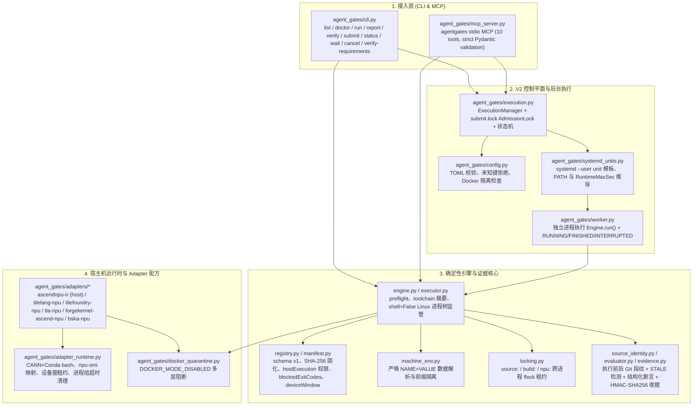

# Architecture

AgentGates 负责确定性执行、资源租约与可验证证据；编译器语义分析由编译器自身承担，代码修改、重构和代码审查由调用方（人类工程师或 AI Agent）完成。仓库不包含编排循环或大模型路由逻辑。

## 1. 分层架构设计

---

## 2. 控制平面与后台异步流水线（V2）

AI Agent 的工具调用常带有限时，且不同开发会话可能并发触发构建/上卡测试。V2 控制平面通过以下设计解耦客户端与长耗时任务：

1. **受控准入（`config.py`）**：
   - `~/.config/agent-gates/config.toml` 定义允许的 `workspaces`、绑定 Adapter、限制的 `allowed_gates`、`env_file` 与全局 `devices` 配置（如 `default_npu_device`、`require_exclusive`、`smi_command`）。
   - 解析器显式拒绝未知配置键（`_check_unknown_keys`）以及任何被隔离的 Docker Adapter 或容器路由 Gate。
2. **原子准入与并发限制（`execution.py`）**：
   - `submit()` 在 `state_root/submit.lock`（`AdmissionLock`）临界区内执行：校验幂等 `request_id`（同请求冲突参数直接报错；相同参数复用既有执行记录）、统计活跃执行数不超过 `worker.max_concurrent`，写入 `executions/<exec_id>.json`（状态 `QUEUED`），随后启动 `agent-gates-worker@<exec_id>.service`。
3. **独立 `systemd --user` Worker（`systemd_units.py` & `worker.py`）**：
   - `systemd_units.py` 从全部已安装 manifest 中推导最长 recipe 超时并叠加 `BACKSTOP_MARGIN_SECONDS`（1800 s）生成 `RuntimeMaxSec`，同时将当前 venv 的 `bin/` 目录注入 unit 的 `Environment="PATH=..."`，避免 worker 找不到 `ninja`/`cmake`/`pytest` 等工具。
   - Worker 启动后重新加载 `config.toml`（若配置在排队期间漂移且校验不通过，捕获 `ConfigError`/`WorkerError` 并把该次执行置为 `INTERRUPTED` + `CONFIG_IDENTITY_CHANGED`），将状态转为 `RUNNING`，调用 `Engine.run()`，最后在 `finally` 中恢复环境变量（如 `AGENT_GATES_SMI_COMMAND`）并落盘 `FINISHED` 与 `run_id`。
4. **严谨的 MCP 服务（`mcp_server.py`）**：
   - 通过 stdio 暴露 10 个工具（`list_workspaces`、`list_gates`、`doctor`、`submit`、`status`、`wait`、`cancel`、`report`、`verify`、`verify_requirements`）。
   - 自定义 `_enforce_strict_arguments` 拒绝任何未声明参数，保证模型无法传参覆盖 shell 命令、环境文件、源码路径或卡号。

---

## 3. 确定性执行引擎与证据核心

1. **`registry.py` 与 `manifest.py`**：
   - 发现内置 adapter 并校验 manifest schema v1：唯一标识符、有向无环门禁依赖、固定 `argv`/`cwd`、内外层超时、以及 `files` 映射中的全量 SHA-256 摘要。
   - **`hostExecution` 声明**：配方必须显式声明 `"permissions": {"hostExecution": true}` 才允许执行。
   - **`blockedExitCodes`**：Adapter 返回列表中的退出码（通常为 `75`）时，引擎将其记为 `BLOCKED_ENV`（`BLOCKED_EXIT_CODE`）而非 `FAIL`，因为测试尚未派发或前置环境被阻塞；`BLOCKED_ENV` 永远无法构成整次运行的 `PASS`。
2. **`machine_env.py`（纯数据机密/环境配置）**：
   - 仅解析严格 `NAME=VALUE` 行，支持注释与空行，剔除成对引号；**从不执行 shell 展开或命令替换**。
   - 前缀严格隔离（如 `TILEFOUNDRY_NPU_*` 不会影响 `TILELANG_NPU_*`）；若调用 shell 导出了与 `env.sh` 冲突的同前缀变量，Gate 立即拒绝而非静默覆盖。
3. **`engine.py` 与 `executor.py`**：
   - `engine.environment()` 将各 Adapter 的配置选择器（如 `TILEFOUNDRY_NPU_ENV_FILE`）、单次授权设备变量（如 `TILEFOUNDRY_NPU_DEVICE_ID`）、独占策略变量（`*_REQUIRE_EXCLUSIVE_DEVICE`）以及宿主 virtualenv 的 `bin/` `PATH` 精确注入子进程。
   - 对 `PATH`、`PYTHONPATH`、`PYTHONHOME`、`LD_PRELOAD`、`LD_LIBRARY_PATH`、`HOME`、`SHELL` 仅以摘要形式记录在收据配置指纹中，既防toolchain漂移又不泄露环境明细。
   - `executor.py` 始终以 `shell=False` 派生受监督进程树，感知父进程存活并在超时或取消时回收整棵派生树。
4. **`locking.py` 与窗口设备租约（Windowed Device Lease）**：
   - 根据标准化真实路径取 `flock`：`source:<root>`、`build:<dir>` 与 `npu:<id>`。
   - 支持两种设备锁模式（同一 Adapter 内不可混用）：
     - **整配方租约**：引擎全程持有 `npu:<id>`。
     - **窗口租约（`deviceWindow: {"waitSeconds": N}`）**：适用于编译/冷启动耗时长但真实上卡短的配方（如 `tilefoundry-npu-device`、`forgekernel-ascend-npu-smoke`、`bska-npu-smoke`）。引擎通过 `AGENT_GATES_DEVICE_LEASE_PATH` / `_RESOURCE` / `_WAIT_SECONDS` 将锁文件交给子配方，使其仅在真正初始化并占用 NPU 计算前取锁、上卡完成后立即释放，并在观测 JSON 中汇报 `windowOpened`/`windowReleased`/`warmupSeconds`/`heldSeconds`/`occupancy`。未按约定上报合法窗口信息的运行会被判为 `INVALID_EVIDENCE`。
5. **`source_identity.py`、`evaluator.py` 与 `evidence.py`**：
   - 在运行前后对 Git tracked/dirty/untracked 文件（含 `.gitignore`、`.git/info/exclude` 与全局 exclude 规则）及忽略的构建产物（如 `libtilelang*.so` 或发布二进制）取 SHA-256 指纹。
   - 观测结果要求严格匹配类型与 JSON 契约：零收集用例、全跳过用例、非零退出或超时均无法成为 `PASS`。
   - `evidence.py` 为收据生成本地 HMAC-SHA256 完整性凭证；后续 `report` / `verify` / `verify-requirements` 会重新核验文件摘要、manifest 摘要与当前源码树指纹——一旦源码、构建产物或 Adapter 脚本发生变化，原收据立即降级为 `STALE` 或 `INVALID_EVIDENCE`。

---

## 4. 共享宿主机运行时与 Docker 隔离

- **[`adapter_runtime.py`](../agent_gates/adapter_runtime.py)**（纯标准库模块）：
  - `parse_env_file` / `resolve_env_file`：共享严格的 `NAME=VALUE` 解析、shell 冲突校验与默认路径发现。
  - `npu_id_of_physical` / `processes_on` / `check_device_ready`：解析 4 列与 5 列（Ascend950PR 新增列，且 `Process name:` 为空时自动跳过占位行）`npu-smi info` 映射表，在只读状态下探测物理卡可用性，并于需要时强制 `require_exclusive_device`（占用或驱动异常返回 exit `75` -> `BLOCKED_ENV`）。
  - `device_window`：提供窗口期 `flock` 上下文管理器并自动计量 `waitSeconds` / `heldSeconds`。
  - `run_host_bash`：使用 `/bin/bash -c` 执行宿主机脚本（自动包裹 `set +u` 以兼容 CANN `set_env.sh` 与 `conda activate`），为每次运行分配独立临时/缓存目录，在独立进程组中执行并在超时后先 `SIGTERM` 再 `SIGKILL`。
- **[`docker_quarantine.py`](../agent_gates/docker_quarantine.py)** & [Docker 模式隔离说明](docker-mode-quarantine.md)：
  - 统一定义了 `DOCKER_MODE_DISABLED` 异常代码、受隔离 Adapter 集合（`tilelang-hivm`、`tilelang-hivm-npu`）及受隔离 Gate 集合（`ascendnpu-ir` 的 `ascend-build` / `ascend-regression`）。
  - 即使人工直接调用容器脚本或 `create-container.sh`（非 `--dry-run`），也会立即失败并打印清晰的恢复指南，避免 root 容器再次污染宿主机文件系统与驱动命名空间。
